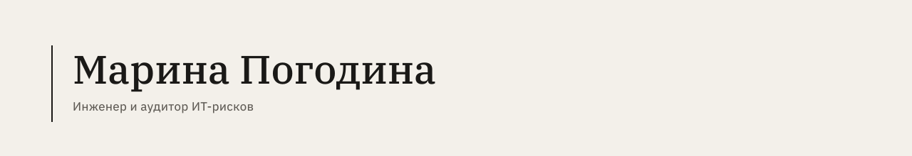

<picture>
  <source media="(prefers-color-scheme: dark)" srcset="assets/header-dark.svg">
  <source media="(prefers-color-scheme: light)" srcset="assets/header-light.svg">
  
</picture>

**Инженер и аудитор ИТ-рисков.** 17 лет в ИТ, из них 14 — в аудите ИТ и внутреннем контроле. Больше 60 аудитов информационной безопасности для компаний топ-100: SOX, COBIT 2019, ISO/IEC 27001, 152-ФЗ, GDPR, работа со стороной регулятора и с BIG4.

Сейчас проектирую и пишу ИИ-сервисы и автоматизацию: боты и мини-приложения, магазины и кабинеты, CRM, команды ИИ-агентов, интеграции и аналитику. Логи, разметка, журнал согласий и проверки закладываются ещё на этапе проектирования. Аудитор во мне знает, какие вопросы задаст проверяющий через год.

<picture>
  <source media="(prefers-color-scheme: dark)" srcset="assets/numbers-dark.svg">
  <source media="(prefers-color-scheme: light)" srcset="assets/numbers-light.svg">
  
</picture>

## Что делаю

<table>
  <tr>
    <td width="50%" valign="top">
<picture>
  <source media="(prefers-color-scheme: dark)" srcset="assets/card-platforms-dark.svg">
  <source media="(prefers-color-scheme: light)" srcset="assets/card-platforms-light.svg">
  
</picture>
    </td>
    <td width="50%" valign="top">
<picture>
  <source media="(prefers-color-scheme: dark)" srcset="assets/card-content-dark.svg">
  <source media="(prefers-color-scheme: light)" srcset="assets/card-content-light.svg">
  
</picture>
    </td>
  </tr>
</table>

<picture>
  <source media="(prefers-color-scheme: dark)" srcset="assets/card-agents-dark.svg">
  <source media="(prefers-color-scheme: light)" srcset="assets/card-agents-light.svg">
  
</picture>
<picture>
  <source media="(prefers-color-scheme: dark)" srcset="assets/card-systems-dark.svg">
  <source media="(prefers-color-scheme: light)" srcset="assets/card-systems-light.svg">
  
</picture>
<picture>
  <source media="(prefers-color-scheme: dark)" srcset="assets/card-docs-dark.svg">
  <source media="(prefers-color-scheme: light)" srcset="assets/card-docs-light.svg">
  
</picture>

Список услуг текстом

- **Боты и мини-приложения** для MAX, Telegram и ВКонтакте: саммари, продажи, антиспам, комментарии с ветками и автоответом, приложения и Mini Apps под задачу.
- Личные кабинеты и веб-платформы под задачу.
- **Полноценный интернет-магазин:** каталог, корзина, оплата, доставка, личный кабинет, обмен с учётной системой.
- **Команда ИИ-агентов с оркестрацией и консультанты по вашим данным.** Собираю штат агентов с ролями: маркетинг, SMM, SEO, контент, публикация, юрист, аналитика и другие профильные задачи. Оркестратор ставит задачи и ведёт их по контурам, агенты работают по расписанию и по событиям. У каждого — роль, память, навыки и инструменты, в том числе MCP-подключения к базам и сервисам. Результаты проходят контроль качества; публикации, платежи и другие внешние действия остаются за человеком в контуре. Консультанты отвечают по вашим документам и показывают источник.
- **Агенты, аналитика и интеграции над любой учётной системой** — 1С, SAP, Битрикс24, amoCRM, МойСклад, Excel, Google Sheets и другими. Метрики, дашборды и BI, Яндекс Метрика и вебаналитика, сквозная аналитика. Обмен с маркетплейсами Wildberries и Ozon, автоматизация документооборота, отчётность.
- CRM: внедрение под процесс, доработка, своя система.
- Мобильные приложения на Flutter для iOS и Android.
- Контент-завод коротких видео: генерация и автопостинг в соцсети.
- Экспертный блог с SEO и GEO: контент-план, статьи, автопостинг, оптимизация под AI-поисковики.
- Автоматизация воронок продаж в соцсетях.
- Сборка под эксперта: продукт, сайт, приложение, ассистент и воронка.
- Обследование и техническое задание перед разработкой.
- Аудит персональных данных по 152-ФЗ.
- Документация по ГОСТ на программную систему.
- Сопровождение системы после запуска.

<picture>
  <source media="(prefers-color-scheme: dark)" srcset="assets/stack-dark.svg">
  <source media="(prefers-color-scheme: light)" srcset="assets/stack-light.svg">
  
</picture>

## Написать

<a href="https://t.me/Marinochcin"><picture>
  <source media="(prefers-color-scheme: dark)" srcset="assets/btn-telegram-dark.svg">
  <source media="(prefers-color-scheme: light)" srcset="assets/btn-telegram-light.svg">
  
</picture></a>
<a href="mailto:marina.y.pogodina@yandex.ru"><picture>
  <source media="(prefers-color-scheme: dark)" srcset="assets/btn-email-dark.svg">
  <source media="(prefers-color-scheme: light)" srcset="assets/btn-email-light.svg">
  
</picture></a>
<a href="https://github.com/unnamed00bas"><picture>
  <source media="(prefers-color-scheme: dark)" srcset="assets/btn-github-dark.svg">
  <source media="(prefers-color-scheme: light)" srcset="assets/btn-github-light.svg">
  
</picture></a>

Telegram: [@Marinochcin](https://t.me/Marinochcin) · Почта: [marina.y.pogodina@yandex.ru](mailto:marina.y.pogodina@yandex.ru) · GitHub: [unnamed00bas](https://github.com/unnamed00bas)
