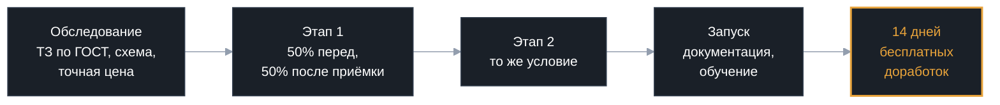

# Марина Погодина

**Инженер и аудитор ИТ-рисков. Делаю [PROMAREN](https://promaren.ru): снимаю с малого и среднего бизнеса ручную работу.**

---

## Что вы поняли за пять секунд

Это тест, которым я разбираю чужие лендинги. Справедливо применить его и к собственному профилю — вот три строки, которые он должен оставить в голове:

| Вопрос | Ответ |
|---|---|
| Что делаю | Мини-приложения в MAX и Telegram, личные кабинеты, CRM, агентов над 1С |
| Кому | Малому и среднему бизнесу, у которого ручная работа съедает людей |
| Что получите | Цену, срок и размер моей неустойки — до договора |

Не сходится — [напишите об этом](https://promaren.ru/contacts/), это тоже полезный разбор.

---

## Условия

Три показания, которые обычно узнают после подписания. Я называю их до.

| Условие | Как это записано в договоре |
|---|---|
| Цена не меняется до запуска | фиксируется на этапе обследования |
| Просрочка по моей вине | стоимость работ уменьшается на 20%, п. 3.2 |
| Оплата | 50% перед этапом, 50% после приёмки; аванса за весь проект нет |
| Репозиторий | на вашем аккаунте с первого дня, с историей изменений |
| Гарантия | 14 дней бесплатных доработок после приёмки |
| Порог | проекты дешевле 150 000 ₽ не беру — в меньший бюджет не помещаются ни обследование, ни документация, ни гарантия |

[Образец договора (PDF)](https://promaren.ru/legal/contract-sample.pdf) · [Цены целиком](https://promaren.ru/prices/)

---

## Как идёт работа

Каждый этап начинается только после предоплаты по нему и передачи доступов — до этого срок не течёт. Просрочил по своей вине — стоимость этапа падает на 20%.

---

## Что делаю

Весь каталог — [promaren.ru/services](https://promaren.ru/services/), цены целиком — [promaren.ru/prices](https://promaren.ru/prices/). Здесь тот же состав, чтобы не пришлось открывать сайт.

### Разработка

| Услуга | Цена | Срок |
|---|---|---|
| Мини-приложения для MAX и Telegram | от 200 000 ₽ | от 4 недель |
| Сайты, личные кабинеты и веб-платформы | от 200 000 ₽ | от 4 недель |
| AI-агенты и консультанты по вашим данным | от 300 000 ₽ | от 4 недель |
| CRM: внедрение под процесс, доработка, своя система | от 500 000 ₽ | от 3 недель |
| AI-агенты над 1С | от 800 000 ₽ | от 4 недель |
| Мобильные приложения на Flutter для iOS и Android | от 1 000 000 ₽ | от 2 месяцев |

### Проверка и документы

| Услуга | Цена | Срок |
|---|---|---|
| Обследование и техническое задание перед разработкой | от 150 000 ₽ | 1–2 недели |
| Аудит персональных данных по 152-ФЗ | от 150 000 ₽ | 5–10 рабочих дней |
| Документация по ГОСТ на программную систему | от 200 000 ₽ | от 3 недель |

### Работа с тем, что уже есть

| Услуга | Цена | Срок |
|---|---|---|
| Интеграции: связать системы, между которыми ходят руками | от 150 000 ₽ | от 2 недель |
| Сопровождение системы после запуска | от 60 000 ₽ в месяц | с любого месяца |

Готовые продукты поверх этих услуг — контент-завод, экспертный блог с SEO и GEO, боты для MAX и Telegram, автоматизация воронок, «бизнес под эксперта» — [promaren.ru/products](https://promaren.ru/products/).

<b>Когда не берусь</b>

 

- **Бюджет меньше 150 000 ₽.** В него не помещаются ни обследование, ни документация, ни гарантия. Работа без них называется иначе и стоит иначе.
- **«Сделайте как у конкурента».** Без своего процесса и своих данных получится копия чужой витрины, которая не продаёт.
- **Задача не моя.** Скажу в первом ответе, обычно в течение двух рабочих дней, и объясню, к кому идти.

<b>Откуда дисциплина в коде</b>

 

17 лет в ИТ и управлении технологическими рисками, из них **14 лет в аудите ИТ и внутреннем контроле**. Более **60 аудитов** ИТ и информационной безопасности для компаний топ-100: SOX, COBIT 2019, ISO/IEC 27001, 152-ФЗ, GDPR, работа со стороной регулятора и с BIG4.

Поэтому логи, разметка, журнал согласий и проверки закладываются на этапе проектирования. Аудитор во мне знает, какие вопросы задаст проверяющий через год.

<b>Чем подкреплено</b>

 

| Замер | Что было |
|---|---|
| Контент-завод, 28 дней | 108 417 просмотров, старт с 12 подписчиков |
| Тот же канал, 41 день | 12 → 90 подписчиков |
| Экспертный блог, 6 месяцев | +2 807% органического трафика |

Разборы этих запусков с методикой и цифрами — [promaren.ru/cases](https://promaren.ru/cases/).

---

## Открытый код

**[studio-orbita-demo](https://github.com/unnamed00bas/studio-orbita-demo)** — многостраничный сайт на Next.js 16 + TypeScript strict с потоковым AI-консультантом на Anthropic Messages API, техническим SEO и разметкой под AI-поисковики. Вымышленный бренд, рабочая архитектура: можно склонировать и запустить за минуту. Каждое решение объяснено в README — почему SSE вместо WebSocket; почему RSC по умолчанию.

Остальные репозитории — рабочие: лендинг с блогом на Payload, боты для MAX и Telegram, конвейер публикаций, пульт управления проектами.

---

## Написать

- Задача и оценка: [promaren.ru/contacts](https://promaren.ru/contacts/)
- Разбор вашей страницы: [promaren.ru/audit](https://promaren.ru/audit/) — пришлите ссылку, вернём разбор
- Почта: [info@promaren.ru](mailto:info@promaren.ru)

Отвечаю лично, обычно в течение двух рабочих дней. Если задача не моя — скажу сразу.
